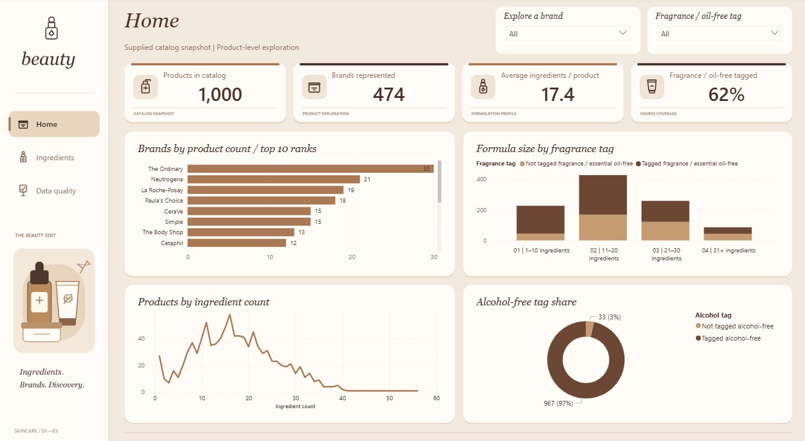
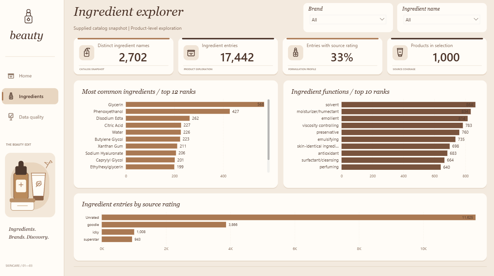
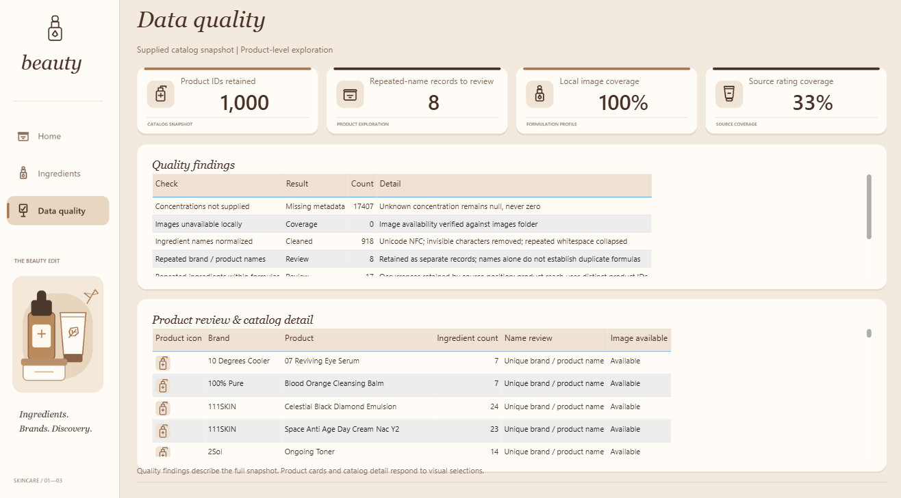

# Skincare Catalog Analytics

A Power BI portfolio project exploring skincare brands, ingredient composition, and catalog data quality. Python transforms the source catalog into analytical tables, while a three-page report makes product and ingredient patterns easy to explore.

## Project at a glance

| Metric | Catalog snapshot |
| --- | ---: |
| Products | 1,000 |
| Brands | 474 |
| Normalized ingredient names | 2,702 |
| Ingredient entries | 17,442 |
| Report pages | 3 |

Counts come from the checked-in [project metrics](portfolio/project_metrics.json) and [cleaning audit](portfolio/cleaning_audit.json).

## Explore the report

### Home

Explore catalog composition through product and brand KPIs, brand comparisons, formula-size groups, alcohol-free tags, and ingredient-count distribution. Brand and fragrance-tag slicers support focused product exploration.

### Ingredient Explorer

Compare ingredient reach across distinct products, explore supplied ingredient functions, and inspect source-rating coverage. Ingredient reach uses distinct product IDs so repeated ingredient entries do not inflate product counts.

### Data Quality

Review repeated product names, missing ingredient metadata, normalization results, and local image coverage. A traceable review queue preserves records that need investigation.

## Open the dashboard

1. Clone or download this repository.
2. Open [Beauty_Studio_Final.pbix](portfolio/Beauty_Studio_Final.pbix) in Power BI Desktop. This is the finished report to view and share.
3. Use the report page tabs to explore all three pages. In Desktop editing mode, use **Ctrl+click** on sidebar navigation buttons.

## License

This repository includes an [MIT License](LICENSE).

## Author

**Dana Elshrbiny** · Data Analyst

[GitHub](https://github.com/danaelshrbiny10) · [LinkedIn](https://www.linkedin.com/in/danaelshrbiny/)
